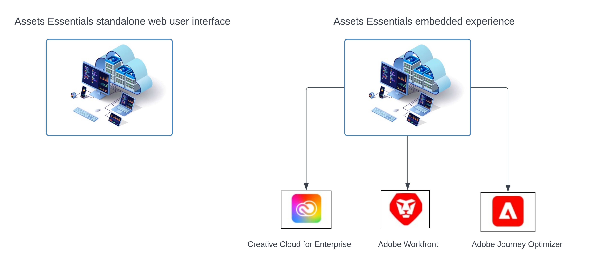

# Présentation d’[!DNL Adobe Experience Manager Assets Essentials] {#assets-essentials}

<!-- 
TBD: Update this banner to remove Beta label. 

-->

Adobe propose des solutions de gestion des actifs digitaux (DAM) robustes qui vous permettent de tirer le meilleur parti de vos ressources numériques. Adobe Experience Manager Assets Essentials est la solution allégée de gestion des ressources d’Adobe pour stocker, gérer, découvrir et exploiter des ressources numériques.

## Qu’est-ce qu’Assets Essentials ? {#assets-essemtials-overview}

Experience Manager Assets Essentials est une édition allégée d’Adobe Experience Manager Assets Cloud Service. Assets Essentials offre une gestion des ressources et une collaboration unifiées avec une interface d’utilisation moderne et simplifiée. Cette solution facile à utiliser permet à un plus grand nombre d’équipes créatives et marketing de stocker, de découvrir et de distribuer leurs ressources numériques.

Assets Essentials vous permet :

* de gérer, d’organiser et de régir les ressources dans un emplacement centralisé.

* Collaborer au développement de contenu entre les équipes.

* d’accéder, de rechercher et de trouver les ressources approuvées finales.

* de partager et de télécharger des ressources pour la diffusion en aval.

## Comment accéder à Assets Essentials ? {#access-options}

Assets Essentials offre une interface d’utilisation web autonome aux utilisateurs et utilisatrices finaux et aux administrateurs et administratrices, leur permettant d’accéder à toutes les fonctionnalités de la solution. Les utilisateurs et utilisatrices d’autres solutions Adobe peuvent également accéder aux ressources d’Assets Essentials et les exploiter au moyen d’une expérience intégrée, disponible dans Creative Cloud abonnement Entreprise, Adobe Journey Optimizer et les applications Adobe Workfront.

## Pourquoi choisir Assets Essentials ? {#assets-essentials-features}

Assets Essentials offre des avantages clés, ce qui vous permet :

* **une prise en main rapide** avec des outils de gestion des actifs prêts à l’emploi.

* d’étendre l’accès aux ressources à davantage d’équipes afin de fournir des expériences client cohérentes avec une **gestion simplifiée des ressources**.

* d’unifier le cycle de vie du contenu à l’aide d’**intégrations natives à d’autres solutions Adobe**.

* de réutiliser une **plateforme cloud**, sécurisée et prête à être mise à l’échelle n’importe où et à tout moment.

* de commencer par les fonctionnalités essentielles de gestion des actifs numériques et de **progresser** jusqu’à la gestion des actifs numériques (DAM) de l’entreprise.

**Prise en main rapide**

La solution Assets Essentials est fournie aux clients par Adobe et disponible une fois le processus d’approvisionnement terminé. Les administrateurs ont accès au produit dans Adobe Admin Console et peuvent immédiatement démarrer la configuration du système et l’intégration des utilisateurs.

En savoir plus sur [l’administration et l’intégration des utilisateurs](deploy-administer.md) d’Assets Essentials.

**Gestion simplifiée des ressources numériques**

L’interface d’utilisation simplifiée d’Assets Essentials facilite la gestion, la découverte et la distribution des ressources numériques. Un vaste ensemble d’utilisateurs provenant de différentes fonctions, y compris les équipes créatives, marketing et métier, peuvent collaborer sur les ressources et accéder aux ressources appropriées et approuvées n’importe où et à tout moment.

Pour plus d’informations, voir [Prise en main de vos besoins en matière de gestion des actifs avec Assets Essentials](get-started.md).

**Intégration à d’autres applications Adobe**

Assets Essentials s’intègre aux solutions Adobe prises en charge et offre une expérience intégrée à partir des interfaces de ces applications. Elle permet aux utilisateurs et utilisatrices d’accéder facilement aux ressources dont ils ont besoin directement dans leur application. Tous les utilisateurs peuvent utiliser les mêmes ressources gérées de manière centralisée dans leurs applications et outils habituels.

L’expérience Assets Essentials intégrée est disponible pour Creative Cloud abonnement Entreprise ainsi que les applications Adobe Journey Optimizer et Adobe Workfront.

Pour plus d’informations, voir [Intégration à d’autres solutions Adobe](integration.md).

**Plateforme cloud**

Basée sur l’infrastructure cloud d’Adobe, Assets Essentials permet aux entreprises de se concentrer sur les besoins de leur activité en matière de création, de gestion et de distribution de ressources numériques. En outre, Adobe garantit que la solution est disponible, sécurisée, évolutive et constamment à jour, avec des innovations de produits fournies aux utilisateurs en toute simplicité via de fréquentes mises à jour.

**Des fonctionnalités qui évoluent avec vous**

Lancez-vous rapidement avec Assets Essentials et bénéficiez des principales fonctionnalités de gestion des actifs digitaux au sein de diverses équipes.

Lorsque les besoins de votre entreprise se développent et que vous avez besoin d’une prise en charge des exigences avancées de gestion des actifs numériques, telles que les personnalisations, l’extensibilité, les intégrations, l’automatisation, Dynamic Media et Brand Portal, Adobe propose également [Adobe Experience Manager Assets as a Cloud Service](https://experienceleague.adobe.com/docs/experience-manager-cloud-service/content/assets/home.html?lang=fr).

## Étapes suivantes {#next-steps}

* Faites des commentaires sur le produit en utilisant l’option [!UICONTROL Commentaires] disponible dans l’interface utilisateur d’Assets Essentials.

* Faites des commentaires sur la documentation en utilisant l’option [!UICONTROL Modifier cette page]  ou [!UICONTROL Enregistrer un problème]  disponible dans la barre latérale droite.

* Contactez l’[assistance clientèle](https://experienceleague.adobe.com/fr?support-solution=General&lang=fr#support).

>[!MORELIKETHIS]
>
>* [[!DNL Assets Essentials] page tutoriels](https://experienceleague.adobe.com/docs/experience-manager-learn/assets-essentials/overview.html?lang=fr)
